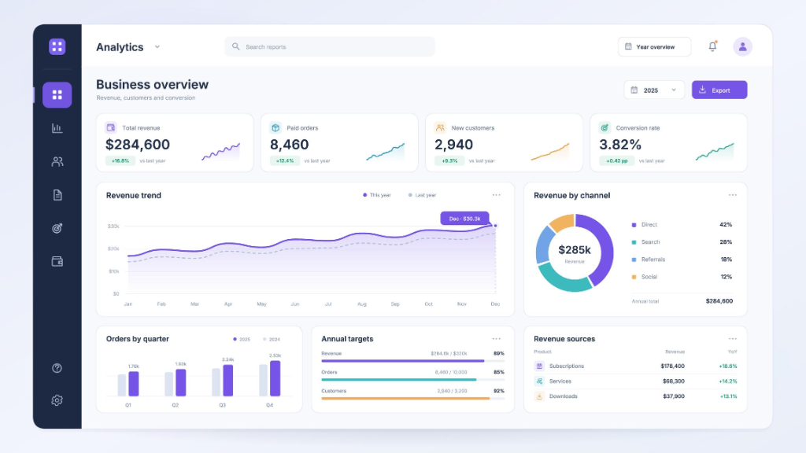

# InsightFlow — Full-Stack Business Analytics Platform

[](https://python.org)
[](https://flask.palletsprojects.com/)
[](https://pandas.pydata.org/)
[](LICENSE)
[]()

> **InsightFlow** is a modern, full-stack business analytics and intelligence web application designed for data analysts, business intelligence engineers, and Python full-stack developers. It enables non-technical and executive users to upload raw business datasets (CSV/Excel), inspect and automatically clean data quality issues, compute real-time business KPIs, visualize multi-dimensional performance across interactive dashboards, and download analytical reports.

---

## 📸 Executive Dashboard Preview



*The executive business overview dashboard featuring real-time KPI metrics, sparkline trends, dual-series revenue trajectories, acquisition channel breakdown donut chart, quarterly order comparisons, and annual target tracking.*

---

## 🎯 Key Features

- **🔐 Enterprise Authentication & Access Control:**
  - Secure account registration, session login, and logout powered by Flask-Login and Werkzeug password hashing.
  - Multi-tenant data isolation ensuring users only access datasets and reports they own.
- **📁 Multi-Format Dataset Management:**
  - Upload CSV and Excel (`.xlsx`, `.xls`) files with strict extension and file-size validation (up to 16MB).
  - Schema discovery: Automatic detection of column names, data types, missing value percentages, and preview tables.
- **🧹 Automated Data Cleaning Engine:**
  - One-click duplicate elimination.
  - Smart imputation: Numeric median replacement and categorical mode resolution.
  - Column header standardization (`snake_case` conversion and special character sanitation).
  - Time-series datetime parsing and conversion.
- **📊 Real-Time Interactive Analytics & KPIs:**
  - **Total Revenue, Paid Orders, New Customers, and Conversion Rate** with YoY growth percentages.
  - **Revenue Trend:** Dual-series cubic-bezier area chart comparing current and previous fiscal years.
  - **Revenue By Acquisition Channel:** Interactive donut visualization with breakdown metrics.
  - **Orders By Quarter:** Grouped bar charts tracking Q1–Q4 seasonal volume.
  - **Target Attainment Meters:** Real-time progress tracking for Revenue, Orders, and Customer targets.
  - **Product Performance Table:** Top-line revenue sources with YoY change indicators.
- **📑 Multi-Format Report Generation & Export:**
  - Instant CSV export and JSON analytical payloads.
  - Browser-native executive PDF print views.
  - Historic report archiving with download management.

---

## 🛠️ Technology Stack

| Layer | Technologies |
| :--- | :--- |
| **Backend Framework** | Python 3.10+, Flask, Flask-SQLAlchemy, Flask-Login, Flask-WTF |
| **Data Engine** | Pandas, NumPy, openpyxl |
| **Database** | SQLite (Development) / PostgreSQL (Production ready via SQLAlchemy ORM) |
| **Frontend & UI** | Modern HTML5, CSS3 Variables, Plus Jakarta Sans, FontAwesome 6, Chart.js 4 |
| **Testing** | pytest, unittest |
| **Deployment** | Gunicorn WSGI, Docker ready, Render / Supabase compatible |

---

## 🏗️ Architecture & Component Flow

```
┌────────────────────────────────────────────────────────┐
│                   Web Browser (Client)                 │
│  - Plus Jakarta Sans Responsive Dashboard UI           │
│  - Interactive Chart.js Visualizations                 │
│  - File Upload & Data Cleaning Workbench               │
└───────────────────────────▲────────────────────────────┘
                            │ HTTP / JSON
┌───────────────────────────▼────────────────────────────┐
│                  Flask Application Core                │
│  ├── /auth        : Registration, Login, Sessions      │
│  ├── /datasets    : Upload, Schema Discovery, Storage  │
│  ├── /analytics   : Cleaning Engine, KPI Aggregator    │
│  └── /reports     : CSV & JSON Report Generators       │
└───────────────▲────────────────────────▲───────────────┘
                │                        │
┌───────────────▼──────────────┐ ┌───────▼───────────────┐
│     SQLAlchemy ORM Layer     │ │   Pandas Analytics    │
│  - SQLite / PostgreSQL       │ │  - Missing Imputation │
│  - Users, Datasets, Jobs,    │ │  - Time-series Aggr   │
│    Analyses, Reports Models  │ │  - KPI Math Engine    │
└──────────────────────────────┘ └───────────────────────┘
```

---

## 📂 Project Structure

```
InsightFlow/
├── app/
│   ├── __init__.py              # Flask Application Factory
│   ├── extensions.py            # SQLAlchemy & LoginManager instances
│   ├── models.py                # Database models (User, Dataset, Report, etc.)
│   ├── auth/                    # Authentication blueprint
│   │   ├── __init__.py
│   │   └── routes.py
│   ├── datasets/                # File upload & inspection blueprint
│   │   ├── __init__.py
│   │   └── routes.py
│   ├── analytics/               # Cleaning & KPI calculation engine
│   │   ├── __init__.py
│   │   ├── routes.py
│   │   ├── cleaning.py          # Automated cleaning pipeline
│   │   ├── metrics.py           # Business KPI mathematics
│   │   └── charts.py            # Chart.js JSON formatting
│   ├── reports/                 # Reporting blueprint
│   │   ├── __init__.py
│   │   └── routes.py
│   ├── templates/               # Jinja2 HTML templates
│   │   ├── base.html            # Dark-rail modern layout shell
│   │   ├── dashboard.html       # Executive Overview Dashboard
│   │   ├── upload.html          # Drag-and-drop file upload
│   │   ├── dataset_list.html    # Datasets catalog
│   │   ├── dataset_detail.html  # Quality inspect & schema table
│   │   ├── cleaning.html        # Interactive cleaning console
│   │   ├── reports.html         # Generated reports archive
│   │   ├── login.html           # Authentication login
│   │   └── signup.html          # Registration form
│   └── static/
│       ├── css/style.css        # Custom UI styling (variables, cards, pills)
│       ├── js/dashboard.js      # Dynamic Chart.js scripts & filters
│       └── img/                 # Dashboard screenshots and icons
├── instance/                    # SQLite database storage (excluded from git)
├── sample_data/
│   └── sales_sample.csv         # 2024-2025 business sample dataset
├── scripts/
│   └── generate_sample_data.py  # Synthetic data generation utility
├── tests/
│   ├── test_auth.py             # Auth & password security tests
│   ├── test_uploads.py          # File parsing & validation tests
│   ├── test_analytics.py        # KPI computation & aggregation tests
│   └── test_cleaning.py         # Imputation & deduplication tests
├── config.py                    # Environment-specific configuration
├── run.py                       # App entry point with auto-seeding
├── requirements.txt             # Project dependencies
├── .env.example                 # Sample environment variables
├── .gitignore                   # Git ignore file
└── LICENSE                      # MIT Open Source License
```

---

## ⚡ Quick Start Guide (Windows / macOS / Linux)

### 1. Clone the Repository
```bash
git clone https://github.com/YOUR_USERNAME/InsightFlow.git
cd InsightFlow
```

### 2. Create and Activate Virtual Environment
```bash
# Windows
python -m venv venv
venv\Scripts\activate

# macOS / Linux
python3 -m venv venv
source venv/bin/activate
```

### 3. Install Dependencies
```bash
python -m pip install --upgrade pip
pip install -r requirements.txt
```

### 4. Configure Environment
```bash
# Copy example configuration
cp .env.example .env
```

### 5. Launch the Platform
```bash
python run.py
```

*The application automatically creates the SQLite database, seeds a pre-configured demo account, and attaches sample business benchmark data.*

- Open **[http://127.0.0.1:5000](http://127.0.0.1:5000)** in your browser.
- **Preloaded Demo Credentials:**
  - **Username:** `admin`
  - **Password:** `admin123`

---

## 🧪 Running Automated Tests

Run the full automated test suite with `pytest`:

```bash
pytest -v
```

All tests for authentication, data cleaning, file uploads, and metric calculations run against an in-memory SQLite database.

---

## 🔒 Security Best Practices Implemented

- **Password Hashing:** Salted hashes generated with Werkzeug's PBKDF2/SHA256 implementations.
- **Resource Ownership:** All SQL queries filter strictly by `user_id == current_user.id` to prevent Insecure Direct Object References (IDOR).
- **Safe Filenames:** Server-side UUID prefixes prevent directory traversal and name collisions.
- **Upload Isolation:** Uploaded user files are stored outside the publicly accessible `static` directory.
- **File Validation:** Size limits (16MB) and strict MIME/extension whitelisting.

---

## 📄 License

Distributed under the MIT License. See [LICENSE](LICENSE) for more details.
